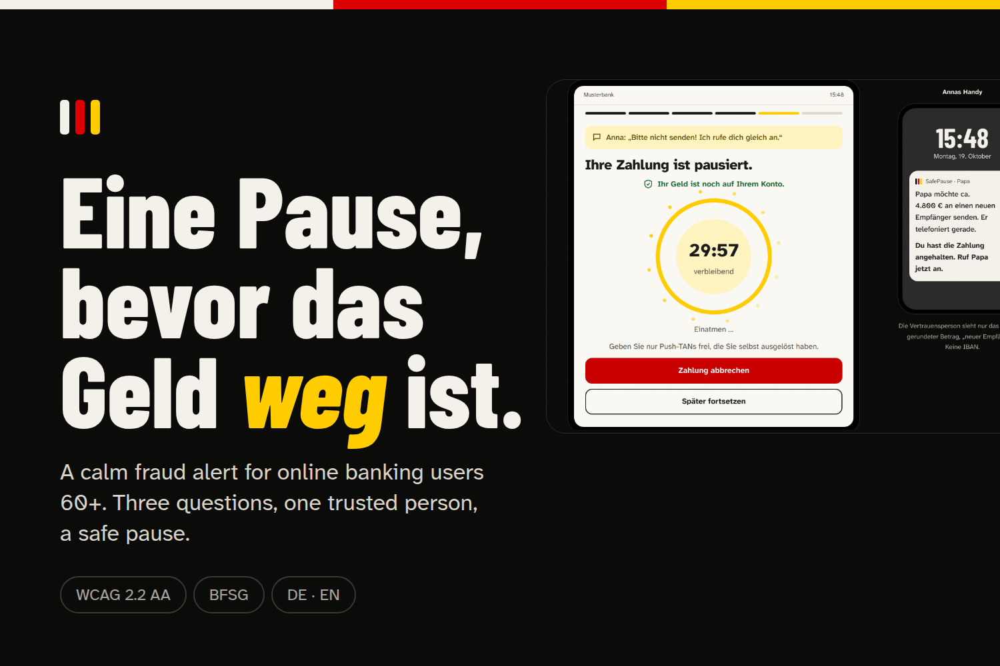

# SafePause



**Eine Pause, bevor das Geld weg ist.** · *A pause before the money is gone.*

SafePause is a calm fraud-alert experience for German online-banking users aged 60+. When a fake bank employee is on the phone and pushes someone to approve a transfer, SafePause slows the moment down: three simple questions, a plain-language explanation, one tap to a trusted person, and a safe pause while the money stays in the account.

Motto: *ruhig, Schritt für Schritt, nie allein* (calm, step by step, never alone).

Built for **Hyperbloom October 2026 – UI/UX and Web Design**.

## Live

| | Link |
|---|---|
| Website + app + API on Deployxa | https://ausl-nder-team.deployxa.online · app: https://ausl-nder-team.deployxa.online/?app |
| Static mirror (Vercel, demo mode) | https://safepause-eine-pause-bevor-das-geld.vercel.app |
| Full-screen web app | https://safepause-eine-pause-bevor-das-geld.vercel.app/?app |
| Autoplay demo (≈1 min, used for the video) | https://safepause-eine-pause-bevor-das-geld.vercel.app/?tour · English: `?tour&lang=en` |
| Screenshots | [`docs/screenshots/`](docs/screenshots) |
| Figma (design system + all screens) | https://www.figma.com/design/zqsFbcjS9xFOHUwD7kcv7V/SafePause |
| Video (1:58) | https://youtu.be/merlbip2d4g |

## The problem

- Phone scams against older people are a live problem in Germany. In 2025 the BKA counted 4,646 reported "fake police officer" cases with €49.5M in losses, and 4,798 grandchild-trick / shock-call cases with €49.0M (PKS 2025, via dpa). There is no separate federal figure for fake bank employees; regional police reports from September–October 2026 show repeated cases (Kassel, Kaiserslautern, Günzburg, Weimar, Memmingen, Hemer, Waldeck-Frankenberg).
- Since 9 October 2025, banks must run **Verification of Payee** (name vs. IBAN) before SEPA transfers. It catches typos and some invoice fraud, but not phone pressure: in a push-TAN scam the name often *matches*. **VoP checks the name, not the intent.**
- Since 28 June 2025, the **BFSG** requires consumer online banking to be accessible; §17 BFSGV limits explanations of banking services to language level B2.

## The flow (6 screens)

1. **Calm notice** – "Diese Überweisung wirkt ungewöhnlich. Lassen Sie uns kurz gemeinsam prüfen."
2. **Three questions**, one per screen: Is someone on the phone? Are you being rushed or asked to keep a secret? Do you know the payee? Plus a shortcut: *"Someone is telling me what to type right now."*
3. **What we noticed** – max. three points in plain words, including the VoP result (match / close match / no match).
4. **Ask someone you trust** – call or text Anna, call the bank on the number on your card, block access via 116 116.
5. **Safe pause** – 30-minute timer with a breathing circle; "Your money is still in your account."
6. **Done** – what to do if the caller returns, report the attempt.

**Trusted Contact Mode:** Anna's phone gets a gentle notice with minimal data (rounded amount, "new payee", no IBAN) and can tap "Please stop".

## Design principles

- Kind-neighbour tone, never BETRUG / ALARM / DRINGEND.
- One action per screen; the safe choice is always the most visible.
- Pause instead of block; "Continue anyway" stays available without pressure.
- Never alone: trusted person and 116 116 are always one tap away.
- Redundant signals: text + icon + (optional) sound; colour never carries meaning alone.
- Palette from the German flag on warm neutrals; inside the app, red is reserved for real danger: the active call and "Cancel payment".

## Accessibility

Targets WCAG 2.2 AA / EN 301 549:

- Contrast ≥ 4.5:1 for all text tokens, measured live on the page; separate high-contrast mode.
- Base text 18 px, two larger text levels, layouts work at 200% text.
- Main buttons 60 px high, every target at least 44 px (WCAG 2.2 AA asks for 24 × 24 px).
- Full keyboard support, visible focus, answers via J/N/? (DE) or Y/N/? (EN).
- Screen-reader labels, live regions, read-aloud via Web Speech API (de-DE / en-GB).
- All motion off with `prefers-reduced-motion`, plus a "pause motion" button.
- Copy at roughly A2–B1, below the legal B2 limit; Simple / Detailed toggle.
- Font: Atkinson Hyperlegible, designed for low-vision readers.

## Judge mode

Open **"Alle Zustände / All states"** in the demo to jump to any screen or scenario: name mismatch, close match, no trusted person, Anna doesn't answer, repeated attempt, pause expired, offline. "Fast-forward pause" shows the expiry state.

## Run it

Everything runs from one server: the backend serves the website and the API on the same port.

**Windows (PowerShell, in the repo folder):**
```powershell
powershell -ExecutionPolicy Bypass -File run.ps1          # website + API, rules + AI texts
powershell -ExecutionPolicy Bypass -File run.ps1 -Laya    # + local Laya model (~1.3 GB on first start)
```

**macOS / Linux:**
```bash
./run.sh            # website + API
./run.sh --laya     # + local Laya model
```

Then open http://127.0.0.1:8000 (website) or http://127.0.0.1:8000/?app (app only). The script creates `backend/.venv`, installs the dependencies and copies `.env.example` to `.env` on first run.

| What you run | What you get |
|---|---|
| `run.ps1` / `run.sh`, no key | Full app; "What we noticed" comes from the backend rules (IBAN, VoP, call phrases, answers, history) with fixed calm texts |
| + `RELAY_API_KEY` in `.env` | The LLM rewrites the findings for the situation; "Check this call" button turns on live speech-to-text |
| + `-Laya` / `--laya` | Laya scores the call transcript locally and adds what the rules missed |
| Static only (`npx serve .`, Vercel, or opening `index.html`) | Same interface, no API: scripted demo texts. The page checks `/api/health` and falls back silently |

The Vercel site is static, so it always runs in demo mode. To point a static page at a running backend elsewhere, add `?api=https://your-backend` to the URL.

## Deploy (Deployxa or any Docker host)

The `Dockerfile` builds one container that serves the website and the API on port 8000. Laya is off in the container (free tiers don't have the RAM for it); rules and LLM texts run.

1. Push this repo to GitHub.
2. In Deployxa: new project → import the GitHub repo → it detects the `Dockerfile`.
3. Set the port to `8000` if asked, and add `RELAY_API_KEY` as an environment variable (optional).
4. Deploy, then open `https://<your-app>/api/health` – it should return `{"ok":true,...}`.

A `Procfile` is included for platforms that run Python without Docker. The static Vercel site keeps working as a fallback demo.

## Tech

- Frontend: plain HTML, CSS and vanilla JavaScript, no build step.
  - `index.html` – markup
  - `css/style.css` – design tokens, themes (dark page, light app screen, high contrast), layout, motion
  - `js/main.js` – copy (DE/EN), app flow and scenarios, animations, map, accessibility, optional API + microphone
- Web Animations API and Canvas (dot-matrix map of Germany), Web Audio API for soft cues, Web Speech API for read-aloud.
- Backend: Python, FastAPI, SQLite (`backend/`), see below.
- Google Fonts: Atkinson Hyperlegible Next, Barlow Condensed.

## Scam detection backend

`backend/` is a small FastAPI server that scores a transfer and the phone call around it, in German and English. Three layers, the first one always runs:

| Layer | What | Where |
|---|---|---|
| Rules (no AI) | IBAN checksum, foreign IBAN, VoP result, new payee, amount, scam words in reference/payee, active call, the 3 answers, night, velocity (repeat payee, attempts per hour, many new payees), reported IBANs, call phrases (fake bank/police story, TAN/PIN/codes, safe account, money requests, pressure, secrecy, remote access, cash pickup, shock call, tech support, fake 116 116). "We will never ask for your PIN" is recognised as negated | `rules.py`, `store.py` |
| Laya (local) | [convaiinnovations/laya](https://huggingface.co/convaiinnovations/laya) answers yes/no questions about the call transcript with calibrated probabilities; only adds what the rules missed. Uses the fine-tuned checkpoint in `backend/models/laya-calls/` if present, zero-shot otherwise | `laya_svc.py`, `laya_train.py` |
| LLM (relay) | `deepseek-v4.1-flash` rewrites the top findings into max. 3 calm points (A2–B1, no BETRUG/ALARM). Falls back to fixed texts if the call fails or breaks the tone rules | `explain.py` |

Score 0–100: below 35 `ok`, 35–59 `notice`, 60+ or a hard flag (invalid IBAN, someone dictating, too many attempts) `pause`. SafePause never blocks; the app decides how to show it.

Speech-to-text: "Anruf mitprüfen / Check this call" in the call card turns on the microphone. The page cuts 16 kHz mono WAV chunks at speech pauses (3–8 s) and sends them to `/api/listen`; the transcript replaces the scripted caller, a calm banner appears when it matches a known trick, and the transfer check uses the real transcript. Model : `qwen3-omni-flash` via the relay. `qwen3-asr-flash-realtime` needs a realtime websocket, which the relay doesn't proxy yet (404), so it's swappable via `STT_MODEL` once it does.

Manual start (what the run scripts do):

```bash
cp .env.example .env          # optional: add RELAY_API_KEY
cd backend
python -m venv .venv && .venv/Scripts/pip install -r requirements.txt   # macOS/Linux: .venv/bin/pip
# NVIDIA GPU (optional): pip install torch --index-url https://download.pytorch.org/whl/cu128
.venv/Scripts/python app.py   # http://127.0.0.1:8000 serves the app + API
pytest -q                     # rule tests
```

The first start downloads Laya (~1.3 GB); until it's loaded the API runs on rules only (`/api/health` shows `laya`). `LAYA_ENABLED=0` skips it.

Fine-tuning Laya (about 5 min on an RTX 5080, the weights stay local in `backend/models/`):

```bash
python laya_train.py gen     # optional : new synthetic DE/EN calls via the relay -> laya_data/
python laya_train.py train   # fine-tune laya-multilingual on laya_data/train.jsonl
python laya_train.py eval    # compare on the held-out laya_data/eval.jsonl
```

`laya_data/` holds 571 training and 144 test calls (8 kinds × DE/EN × full call, 5-second fragment, raw speech-to-text), generated by `deepseek-v4.1-flash`, including genuine bank, police and hospital calls as hard negatives. Results on the 144 held-out calls:

| | Scams flagged DE / EN | Normal calls flagged DE / EN | Laya `scam_type` accuracy |
|---|---|---|---|
| Rules only | 89% / 97% | 3% / 0% | – |
| Rules + zero-shot Laya | 94% / 97% | 33% / 11% | 53% |
| Rules + fine-tuned Laya | 100% / 97% | 3% / 3% | 94% |

The one German "normal" call that gets flagged is a scam the generator mislabelled.

| Endpoint | Body | Returns |
|---|---|---|
| `POST /api/check` | `{lang, uid, sid, tx:{payee, iban, amount, purpose, vop, newPayee}, ctx:{onCall, answers, dictated, hour}, transcript}` | `level, score, signals, points` |
| `POST /api/call` | `{sid, lang, text}` | live call risk for the session transcript |
| `POST /api/listen?sid=&lang=` | WAV bytes | same, after speech-to-text |
| `POST /api/report` | `{iban, note}` | marks an IBAN as reported |

Data: call transcripts stay in memory for 1 hour. SQLite (`backend/data/`) logs each check (IBAN, amount, score, signal codes) for velocity rules. The LLM gets the rounded amount, VoP result and the last 500 characters of the call, never the IBAN or names.

## Testing

`tests/qa.py` drives the site in a headless browser (Playwright) and checks every claim in this README: all eight scenarios, the full Herr Klaus flow, Anna's "Please stop", keyboard answers in DE and EN, button height and minimum text size on every app screen, colour contrast in light, dark and high-contrast mode, focus visibility, reflow at 200% text and at 320 px, reduced motion, and an axe-core WCAG 2.2 AA scan of the landing page and the app.

Latest run: **36 / 36 passed**, 0 axe-core violations.

```bash
cd tests
pip install playwright && python -m playwright install chromium
npm i axe-core
python qa.py
```

Backend rule tests: `cd backend && pytest -q` (14 tests).

## Honest limitations

- This is a UX prototype. The bank, people and transfers are fictional. Without the backend no data is stored or sent; with it, see "Data" above.
- The detection numbers above come from synthetic calls written by an LLM. Real calls are messier; they are a sanity check, not a validation. Zero-shot Laya flags a third of normal German calls, so only use it fine-tuned.
- Speech-to-text through the relay takes roughly 0.6–1× the audio length. The microphone only hears the caller when the call is on speaker.
- A browser cannot detect an active phone call; the call signal is simulated. A real banking app would use OS signals where available and question 1 otherwise.
- VoP results and risk scoring would come from the bank.
- "Designed with BFSG and WCAG 2.2 in mind", not certified compliant.
- We have not yet run a structured test with older users; that is the next step.

## Built during the hackathon

The concept and early sketches existed before registration. The code, final designs, copy and research summary in this repository were built during the event (11–19 October 2026).

## AI tools disclosure

We used Claude (Anthropic) to help with research, copywriting and front-end code. The backend uses the open Laya model and an LLM via a relay at runtime, and the Laya training data was generated with an LLM (see above). All design decisions and content were reviewed by the team.

## Team

- Mirzobehruz Shaidov ([@KanekiH4iSE](https://github.com/KanekiH4iSE)) – *role*
- [@Nems1337](https://github.com/veyselpavyoncuoglu) – backend, scam detection rules, Laya fine-tuning, live call check
- *Name – role*

## License

MIT – see `LICENSE`.
